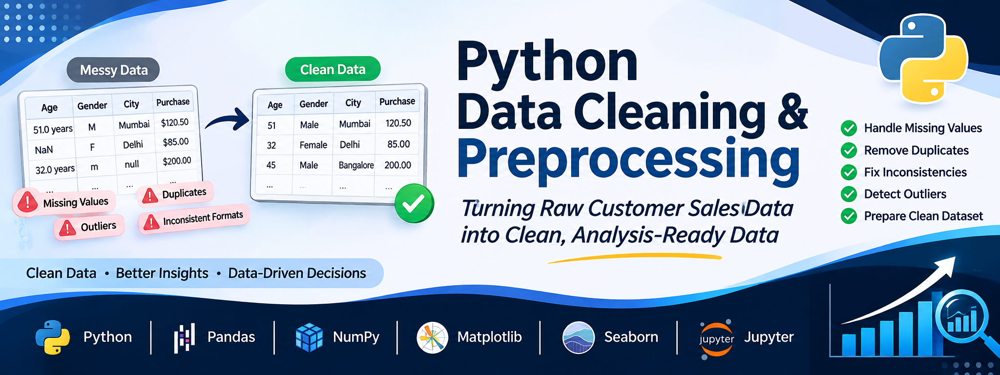
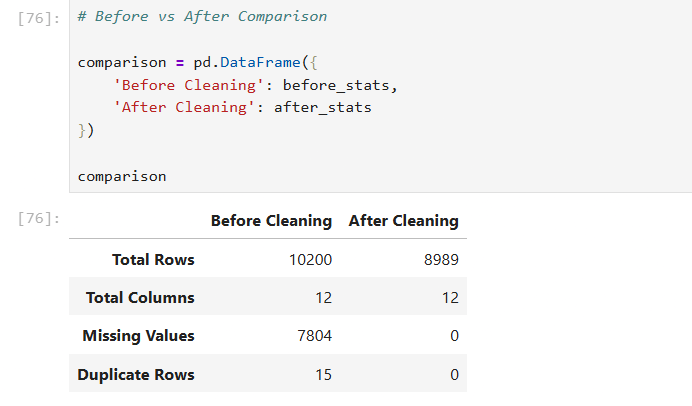

# 📊 Python Data Cleaning & Preprocessing

### Turning Raw Customer Sales Data into Clean, Analysis-Ready Data
<p align="center">
  
</p>
<p align="center">
  
  
  
  
</p>
---

## 📌 About the Project

Raw data is rarely ready for analysis. It often contains missing values, duplicate records, inconsistent formats, and unusual observations.

This project demonstrates an end-to-end data cleaning workflow using Python to transform a messy customer sales dataset into a structured and analysis-ready format.

The focus is on applying practical data preprocessing techniques using **Pandas and NumPy**, along with visual exploration using Matplotlib and Seaborn.

## 🎯 Project Objectives

- Improve data quality and consistency.
- Identify and handle missing values.
- Detect duplicate records and remove them.
- Standardize inconsistent data formats.
- Identify and handle statistical outliers.
- Prepare a clean dataset for further analysis.

## 🛠️ Tools & Technologies

| Tool | Purpose |
|---|---|
| Python | Programming |
| Pandas | Data manipulation and cleaning |
| NumPy | Numerical operations |
| Matplotlib | Data visualization |
| Seaborn | Statistical visualization |
| Jupyter Notebook | Interactive development |

## 🔍 Data Cleaning Workflow

| Step | Process |
|---|---|
| 01 | Data loading and initial inspection |
| 02 | Identifying missing values |
| 03 | Handling missing values using Mean, Median and Mode |
| 04 | Correcting inconsistent values and formats |
| 05 | Removing duplicate records |
| 06 | Converting columns to appropriate data types |
| 07 | Detecting outliers using Z-score |
| 08 | Visualizing outliers using Boxplots |
| 09 | Exporting the cleaned dataset |

## 📂 Repository Structure

```text
python-data-cleaning/
│
├── DataCleaning_using_Python.ipynb
├── messy_customer_sales_data.csv
├── customer_sales_cleaned_data.csv
└── README.md
```

## 🚀 Getting Started

**1. Clone the repository**

```bash
git clone https://github.com/ShreyaWalunj15/python-data-cleaning.git
```

**2. Navigate to the project folder**

```bash
cd python-data-cleaning
```

**3. Install dependencies**

```bash
pip install pandas numpy matplotlib seaborn jupyter
```

**4. Launch Jupyter Notebook**

```bash
jupyter notebook
```

Open `DataCleaning_using_Python.ipynb` and run the cells sequentially.

## 📁 Dataset Files

- **Original Dataset:** `messy_customer_sales_data.csv`
- **Cleaned Dataset:** `customer_sales_cleaned_data.csv`

## 📊 Before vs. After Data Cleaning

<p align="center">
  
</p>

## 💡 Key Learning Outcomes

Through this project, I gained practical experience in:

- Exploring and understanding raw datasets.
- Applying different data imputation techniques.
- Cleaning inconsistent and unstructured data.
- Performing statistical outlier detection.
- Using Python libraries for data preprocessing.
- Creating reproducible data cleaning workflows.

---

### 👩‍💻 Author

**Shreya Walunj**

MCA Graduate | Aspiring Data Analyst

[GitHub](https://github.com/ShreyaWalunj15) · [LinkedIn](https://linkedin.com/in/shreya-walunj-a92b53218)

---

<p align="center">
  ⭐ If you find this project useful, consider giving it a star!
</p>
